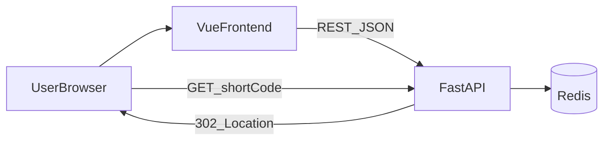
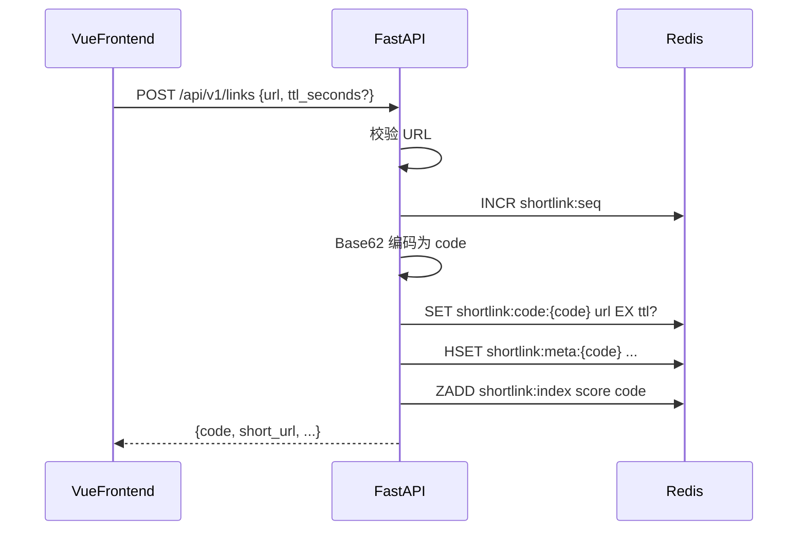
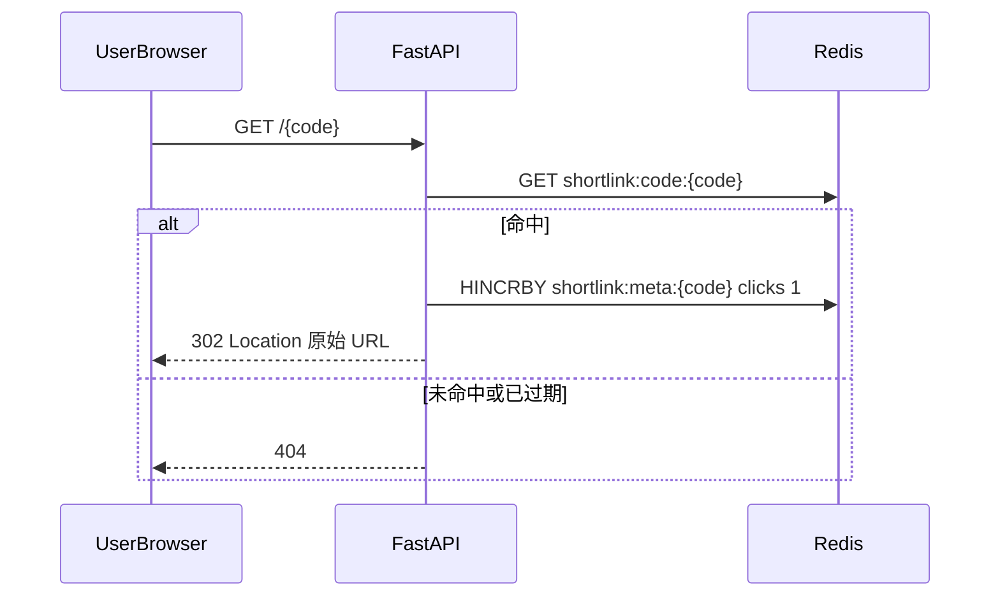
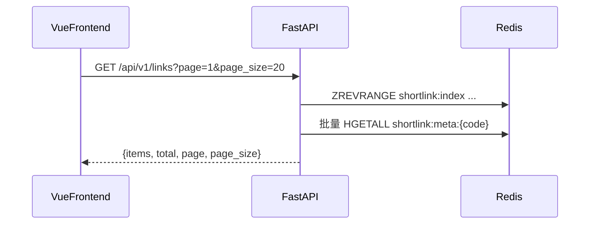

# FastAPI 短链接微服务 — 完整开发文档

> 技术选型：**FastAPI + Redis only**（无 PostgreSQL）+ **Vue 3 + TypeScript** 管理端  
> 目标：可照着实现的开发文档，兼顾前后端分离练习

---

## 1. 项目概述

### 1.1 业务目标

将长 URL 转换为短码（short code），对外提供短链接访问；访问短链时 302 跳转到原始长链。

本服务支持：

| 能力 | 说明 |
|------|------|
| 创建短链 | 提交长 URL，返回短链 |
| 公开跳转 | `GET /{code}` → 302 到原始 URL，并累计点击数 |
| 列表 / 详情 | 管理端分页查看、查看点击数与过期信息 |
| 删除短链 | 删除映射与索引 |
| 可选过期 | 创建时指定 TTL（秒），到期后自动失效 |

### 1.2 非目标（当前版本不做）

- 不落库到 RDBMS（PostgreSQL / MySQL 等）
- 不做多租户、账号体系、复杂鉴权
- 不做自定义短码别名、批量导入、开放平台 SDK
- 不做复杂风控（黑名单、钓鱼检测等）

### 1.3 技术栈

| 层级 | 技术 |
|------|------|
| 后端 API | FastAPI、Uvicorn、Pydantic Settings |
| 存储 | Redis（映射、元数据、序列号、列表索引） |
| 短码算法 | Redis `INCR` + Base62（最小长度 6） |
| 前端管理端 | Vue 3、TypeScript、Vite、Vue Router、Pinia |
| 本地依赖 | Docker Compose 启动 Redis |
| HTTP | JSON REST；公开跳转为 302 |

### 1.4 仓库目录约定

```text
FastAPI-shortlink/
├── backend/                 # FastAPI 服务
│   ├── app/
│   │   ├── main.py          # 入口、CORS、路由挂载
│   │   ├── config.py        # 环境变量
│   │   ├── api/             # 路由
│   │   ├── services/        # 短码、Redis CRUD、点击统计
│   │   ├── schemas/         # Pydantic 模型
│   │   └── deps.py          # 依赖注入（Redis 客户端等）
│   ├── requirements.txt
│   ├── .env.example
│   └── tests/
├── frontend/                # Vue3 + TS 管理端
│   ├── src/
│   │   ├── api/             # 调用后端的封装
│   │   ├── views/           # 页面
│   │   ├── router/
│   │   ├── stores/
│   │   └── types/           # 与后端字段对齐的 TS 类型
│   ├── .env.example
│   ├── package.json
│   └── vite.config.ts
├── docs/
│   └── DEVELOPMENT.md       # 本文档
├── docker-compose.yml
└── README.md
```

前后端分离约定：

- **后端**只提供 JSON API 与公开跳转，不渲染业务页面。
- **前端**独立部署/独立开发端口，通过 `VITE_API_BASE_URL` 访问后端。
- 联调依赖 CORS（或 Vite 代理），见第 7 章。

---

## 2. 架构设计

### 2.1 组件关系



- **管理路径**：浏览器打开 Vue 管理端 → 调用 `/api/v1/links*` → FastAPI 读写 Redis。
- **跳转热路径**：用户访问短链 `GET /{code}` → FastAPI 读 Redis → 存在则 302，并 `HINCRBY` 点击数；不存在则 404。
- **无 DB 回源**：Redis 未命中即视为不存在（Redis-only 架构）。

### 2.2 创建短链流程



### 2.3 访问短链流程



### 2.4 管理端列表示意



---

## 3. Redis 数据模型

### 3.1 Key 设计

| Key | 类型 | 用途 | TTL |
|-----|------|------|-----|
| `shortlink:seq` | String（整数） | 全局自增序列，生成短码 | 永不过期 |
| `shortlink:code:{code}` | String | 短码 → 原始 URL（跳转热路径） | 可选，与创建时 TTL 一致 |
| `shortlink:meta:{code}` | Hash | 元数据：`original_url`、`created_at`、`clicks`、`ttl_seconds` | 与 code 相同 |
| `shortlink:index` | ZSET | member=`code`，score=`created_at`（Unix 秒），供列表分页 | 成员需手动/惰性清理 |

**Hash 字段约定（`shortlink:meta:{code}`）**

| 字段 | 类型（逻辑） | 说明 |
|------|--------------|------|
| `original_url` | string | 原始长链 |
| `created_at` | string（ISO8601 或 Unix 秒） | 创建时间；建议存 Unix 秒字符串便于排序一致 |
| `clicks` | string（整数） | 点击次数，默认 `"0"` |
| `ttl_seconds` | string（整数或空） | 创建时 TTL；空表示永不过期 |

### 3.2 短码算法（INCR + Base62）

1. `n = INCR shortlink:seq`
2. 将 `n` 转为 Base62（字符集：`0-9a-zA-Z`）
3. 若长度不足 **6**，左侧补 `0`（或从足够大的起始序号开始，避免过短码）

示例（伪代码）：

```python
ALPHABET = "0123456789abcdefghijklmnopqrstuvwxyzABCDEFGHIJKLMNOPQRSTUVWXYZ"

def to_base62(n: int, min_length: int = 6) -> str:
    if n == 0:
        s = ALPHABET[0]
    else:
        chars = []
        while n:
            n, rem = divmod(n, 62)
            chars.append(ALPHABET[rem])
        s = "".join(reversed(chars))
    return s.rjust(min_length, ALPHABET[0])
```

优点：实现简单、同 redis 实例内无碰撞、按序递增易排查。  
注意：短码可被枚举猜测；本 MVP 不做鉴权，生产可加签名短码或限流。

### 3.3 过期与索引清理

- 对 `shortlink:code:{code}` 与 `shortlink:meta:{code}` 设置**相同** `EXPIRE` / `SET ... EX`。
- `shortlink:index` 中的 member **不会**随 key TTL 自动删除。
- 推荐策略（二选一或组合）：
  1. **惰性清理**：列表接口读取 meta 时若 key 不存在，则 `ZREM shortlink:index code`。
  2. **定时任务**（可选）：定期 `ZRANGE` 扫描，清理无 meta 的 member。

删除短链时必须同时：

```text
DEL shortlink:code:{code}
DEL shortlink:meta:{code}
ZREM shortlink:index {code}
```

### 3.4 Redis-only 风险说明

- 进程/容器重启后数据依赖 Redis 持久化（建议开启 **AOF** 或至少 **RDB**）。
- 无 RDBMS 时无法做复杂历史审计与跨机房强一致备份；本 MVP 接受该边界。
- 开发环境可用无持久化 Redis；演示/准生产务必在 `docker-compose` 中配置 `appendonly yes`。

---

## 4. API 设计

### 4.1 通用约定

**Base URL（开发）**：`http://localhost:8000`

**统一成功响应**（管理 API）：

```json
{
  "code": 0,
  "message": "ok",
  "data": {}
}
```

**统一错误响应**：

```json
{
  "code": 40001,
  "message": "invalid url",
  "data": null
}
```

建议业务错误码：

| code | HTTP | 含义 |
|------|------|------|
| 0 | 200 | 成功 |
| 40001 | 400 | 参数错误（非法 URL、非法 TTL 等） |
| 40401 | 404 | 短链不存在或已过期 |
| 50000 | 500 | 服务内部错误 |

公开跳转 `GET /{code}` 直接返回 **302 / 404**，不包一层 JSON。

**CORS**：允许前端开发源，例如 `http://localhost:5173`（由配置 `CORS_ORIGINS` 控制）。

### 4.2 健康检查

```http
GET /health
```

响应示例：

```json
{
  "status": "ok",
  "redis": "ok"
}
```

### 4.3 创建短链

```http
POST /api/v1/links
Content-Type: application/json
```

请求体：

```json
{
  "url": "https://example.com/very/long/path?q=1",
  "ttl_seconds": 86400
}
```

| 字段 | 必填 | 说明 |
|------|------|------|
| `url` | 是 | 须为合法 http/https URL |
| `ttl_seconds` | 否 | 过期秒数；省略或 `null` 表示不过期；建议上限如 31536000（1 年） |

成功 `data`：

```json
{
  "code": "000001",
  "original_url": "https://example.com/very/long/path?q=1",
  "short_url": "http://localhost:8000/000001",
  "created_at": 1710000000,
  "ttl_seconds": 86400,
  "clicks": 0
}
```

### 4.4 分页列表

```http
GET /api/v1/links?page=1&page_size=20
```

| 参数 | 默认 | 说明 |
|------|------|------|
| `page` | 1 | 从 1 开始 |
| `page_size` | 20 | 建议上限 100 |

成功 `data`：

```json
{
  "items": [
    {
      "code": "000001",
      "original_url": "https://example.com/...",
      "short_url": "http://localhost:8000/000001",
      "created_at": 1710000000,
      "ttl_seconds": 86400,
      "clicks": 3
    }
  ],
  "total": 1,
  "page": 1,
  "page_size": 20
}
```

实现提示：`ZCARD` 得 total；`ZREVRANGE` 按 score 倒序分页；批量取 meta；惰性清理已过期项。

### 4.5 详情

```http
GET /api/v1/links/{code}
```

成功 `data` 同创建响应中的链接对象；不存在返回 `40401`。

### 4.6 删除

```http
DELETE /api/v1/links/{code}
```

成功 `data` 可为 `null`；不存在返回 `40401`。

### 4.7 公开跳转

```http
GET /{code}
```

- 命中：`302`，`Location: <original_url>`，并 `HINCRBY ... clicks 1`
- 未命中：`404`（可返回简单文本或 JSON，与管理 API 风格可不统一）

注意：路由注册时，`/{code}` 不要与 `/api`、`/health`、`/docs` 冲突；可用路径前缀或短码字符集校验区分。

---

## 5. 后端模块划分（实现指引）

### 5.1 推荐文件结构

```text
backend/
├── app/
│   ├── __init__.py
│   ├── main.py
│   ├── config.py
│   ├── deps.py
│   ├── api/
│   │   ├── __init__.py
│   │   ├── health.py
│   │   ├── links.py          # /api/v1/links*
│   │   └── redirect.py       # /{code}
│   ├── schemas/
│   │   ├── __init__.py
│   │   ├── common.py         # ApiResponse
│   │   └── link.py           # CreateLinkRequest, LinkOut, LinkListOut
│   └── services/
│       ├── __init__.py
│       ├── base62.py
│       └── shortlink.py      # 创建/查询/列表/删除/跳转+点击
├── requirements.txt
├── .env.example
└── tests/
    ├── test_base62.py
    └── test_api_links.py
```

### 5.2 配置项（`config.py` / 环境变量）

| 变量 | 示例 | 说明 |
|------|------|------|
| `REDIS_URL` | `redis://localhost:6379/0` | Redis 连接 |
| `BASE_URL` | `http://localhost:8000` | 拼 `short_url` 用 |
| `CORS_ORIGINS` | `http://localhost:5173` | 逗号分隔多源 |
| `APP_ENV` | `dev` | 环境标识 |

`.env.example` 示例：

```env
REDIS_URL=redis://localhost:6379/0
BASE_URL=http://localhost:8000
CORS_ORIGINS=http://localhost:5173
APP_ENV=dev
```

### 5.3 依赖建议（`requirements.txt`）

```text
fastapi>=0.110
uvicorn[standard]>=0.27
redis>=5.0
pydantic-settings>=2.0
httpx>=0.27          # 测试用
pytest>=8.0
pytest-asyncio>=0.23
```

使用 `redis.asyncio` 异步客户端，与 FastAPI 协程模型一致。

### 5.4 `main.py` 要点

- 创建 `FastAPI` 应用，标题如 `Shortlink API`
- 挂载 CORSMiddleware（`allow_origins` 来自配置）
- `include_router`：health、links（prefix `/api/v1`）、redirect
- lifespan 中初始化 / 关闭 Redis 连接池

### 5.5 Service 层职责

`services/shortlink.py` 建议方法：

| 方法 | 职责 |
|------|------|
| `create_link(url, ttl_seconds)` | INCR → Base62 → 写 code/meta/index |
| `get_link(code)` | 读 meta；不存在抛业务异常 |
| `list_links(page, page_size)` | ZSET 分页 + 惰性清理 |
| `delete_link(code)` | DEL + ZREM |
| `resolve_and_click(code)` | GET code → HINCRBY → 返回 URL |

路由层只做参数校验与响应包装，不直接散落 Redis 命令。

---

## 6. 前端模块划分（Vue 3 + TypeScript）

### 6.1 技术与目录

```text
frontend/
├── src/
│   ├── main.ts
│   ├── App.vue
│   ├── api/
│   │   ├── http.ts           # axios/fetch 封装 + baseURL
│   │   └── links.ts          # create / list / get / delete
│   ├── types/
│   │   └── link.ts           # 与后端字段对齐
│   ├── views/
│   │   ├── CreateLinkView.vue
│   │   ├── LinkListView.vue
│   │   └── LinkDetailView.vue
│   ├── router/index.ts
│   └── stores/links.ts       # 可选 Pinia
├── .env.example
├── index.html
├── package.json
├── tsconfig.json
└── vite.config.ts
```

### 6.2 与后端对齐的 TypeScript 类型

```typescript
/** 与后端 Link 对象字段对齐 */
export interface LinkItem {
  code: string;
  original_url: string;
  short_url: string;
  created_at: number;
  ttl_seconds: number | null;
  clicks: number;
}

export interface ApiResponse<T> {
  code: number;
  message: string;
  data: T;
}

export interface LinkListData {
  items: LinkItem[];
  total: number;
  page: number;
  page_size: number;
}

export interface CreateLinkBody {
  url: string;
  ttl_seconds?: number | null;
}
```

练习点：改后端字段时同步改 `types/link.ts`，用 TS 编译期发现前后端不一致。

### 6.3 页面职责

| 页面 | 路由 | 行为 |
|------|------|------|
| 创建短链 | `/` 或 `/create` | 表单提交 `POST /api/v1/links`，展示 `short_url`，可一键复制 |
| 短链列表 | `/links` | 分页表格：短码、原链、点击、创建时间、操作（详情/删除） |
| 详情 | `/links/:code` | `GET` 详情；展示点击数、TTL |

### 6.4 环境与代理

`.env.example`：

```env
VITE_API_BASE_URL=http://localhost:8000
```

`src/api/http.ts` 使用 `import.meta.env.VITE_API_BASE_URL`。

可选：在 `vite.config.ts` 配置代理，避免本地 CORS：

```ts
server: {
  port: 5173,
  proxy: {
    "/api": { target: "http://localhost:8000", changeOrigin: true },
    "/health": { target: "http://localhost:8000", changeOrigin: true },
  },
}
```

若用代理，前端请求可写相对路径 `/api/v1/...`，此时 `VITE_API_BASE_URL` 可为空字符串。  
**注意**：浏览器直接打开短链跳转仍访问后端 `BASE_URL`（如 `http://localhost:8000/{code}`），不必走 Vite。

### 6.5 前后端分离联调要点

1. 先起 Redis，再起后端，再起前端。
2. 确认 CORS 或 Vite proxy 二选一配置正确。
3. 创建后复制 `short_url`，在新标签页打开，应 302 到原站。
4. 回到列表刷新，点击数应增加。

---

## 7. 本地开发与运行

### 7.1 前置条件

- Python **3.11+**
- Node.js **18+**
- Docker / Docker Compose（运行 Redis）

### 7.2 启动 Redis

仓库根目录 `docker-compose.yml` 建议片段：

```yaml
services:
  redis:
    image: redis:7-alpine
    ports:
      - "6379:6379"
    command: ["redis-server", "--appendonly", "yes"]
    volumes:
      - redis_data:/data

volumes:
  redis_data:
```

启动：

```bash
docker compose up -d redis
```

### 7.3 启动后端

```bash
cd backend
python -m venv .venv

# Windows PowerShell
.\.venv\Scripts\Activate.ps1

# macOS / Linux
# source .venv/bin/activate

pip install -r requirements.txt
copy .env.example .env   # Windows；或 cp .env.example .env
uvicorn app.main:app --reload --host 0.0.0.0 --port 8000
```

验证：

- Swagger：`http://localhost:8000/docs`
- Health：`http://localhost:8000/health`

### 7.4 启动前端

```bash
cd frontend
npm install
copy .env.example .env   # 或 cp
npm run dev
```

浏览器打开：`http://localhost:5173`

### 7.5 联调检查清单

- [ ] Redis 可连，`/health` 返回 redis ok
- [ ] 管理端可创建短链，返回 `short_url`
- [ ] 列表能看到刚创建的项
- [ ] 浏览器访问 `short_url` 发生 302 跳转
- [ ] 再次打开详情/列表，`clicks` 增加
- [ ] 删除后列表消失，短链访问 404
- [ ] 带 `ttl_seconds` 创建，过期后 404（可用短 TTL 如 10 秒验证）
- [ ] 前端跨域或代理无报错

---

## 8. 部署与运维（MVP）

### 8.1 Compose 服务规划

```yaml
services:
  redis:
    image: redis:7-alpine
    command: ["redis-server", "--appendonly", "yes"]
    volumes:
      - redis_data:/data
    restart: unless-stopped

  backend:
    build: ./backend
    environment:
      REDIS_URL: redis://redis:6379/0
      BASE_URL: https://short.example.com
      CORS_ORIGINS: https://admin.example.com
    ports:
      - "8000:8000"
    depends_on:
      - redis
    restart: unless-stopped

  # 可选：用 Nginx 托管 frontend/dist，并反代 /api 与跳转
  # frontend:
  #   ...
```

前端构建：

```bash
cd frontend
npm run build
# 产物在 dist/，由 Nginx 或静态托管提供
```

生产常见拓扑：

- Nginx：`/` → 前端静态；`/api/`、`/health`、短码路径 → 后端  
  或短码与 API 同域由后端统一提供，管理端另域。

### 8.2 配置项表（部署核对）

| 配置 | 开发 | 生产注意 |
|------|------|----------|
| `REDIS_URL` | localhost | 使用服务名 `redis`，勿暴露公网 6379 |
| `BASE_URL` | `http://localhost:8000` | 对外可访问的短链域名 |
| `CORS_ORIGINS` | `http://localhost:5173` | 管理端真实域名；勿用 `*` 配 credentials |
| Redis AOF | 建议开 | 生产必须开，并做好卷备份 |

### 8.3 健康检查

- 探针请求：`GET /health`
- 编排层可据此做 `liveness` / `readiness`（readiness 应检查 Redis ping）

### 8.4 数据与备份边界

- 数据全在 Redis：备份 = Redis RDB/AOF 卷快照。
- 误删 `shortlink:seq` 会导致短码从较小值重新增长，可能与历史码冲突——生产删除 key 需谨慎；迁移时保留 seq。
- 本架构**不提供**跨版本 schema 迁移；演进到 PostgreSQL 时需另做双写/导入方案（见第 10 章）。

---

## 9. 测试与验收

### 9.1 后端建议用例（pytest）

| 用例 | 断言要点 |
|------|----------|
| `test_base62_padding` | 小整数输出长度 ≥ 6，字符集合法 |
| `test_create_link` | 201/200，返回 code、short_url；Redis 有对应 key |
| `test_create_invalid_url` | 400 / `40001` |
| `test_redirect` | 创建后 GET `/{code}` 为 302，Location 正确；clicks +1 |
| `test_redirect_missing` | 404 |
| `test_list_pagination` | 多条数据时 page/page_size 正确 |
| `test_delete` | 删除后详情与跳转均 404，index 无该 member |
| `test_ttl_expiry` | 短 TTL 过期后跳转 404（可用 fake 时间或极短 TTL + sleep） |

测试可用独立 Redis DB（如 `/15`）或 `fakeredis`，避免污染开发库。

### 9.2 手工验收标准

1. 创建合法长链成功，非法 URL 被拒绝。  
2. 短链 302 跳转正确，重复访问点击数累加。  
3. 列表分页、详情、删除行为正确。  
4. TTL 到期后不可访问。  
5. Vue 管理端三个页面可用，无控制台 CORS/类型错误。  
6. `/health` 在 Redis 断开时能反映异常（可选加强）。

---

## 10. 后续扩展（路线图）

以下不在本 MVP 实现范围，仅作演进参考：

| 方向 | 说明 |
|------|------|
| PostgreSQL 持久化 | Redis 作缓存，PG 作权威存储；跳转 miss 时回源 |
| 自定义短码 | 创建时可选 `custom_code`，需唯一性校验 |
| 鉴权 | API Key / JWT，保护写接口 |
| 限流 | 按 IP / API Key 限制创建与跳转 |
| 统计增强 | 按日点击、Referer、独立访客 |
| 管理端体验 | 二维码、批量导出、过期筛选 |

---

## 附录 A：错误与边界场景

- 超长 URL：建议限制长度（如 2048），防止异常大 value。  
- 短码字符：仅 Base62，路径参数校验失败直接 404。  
- 并发创建：依赖 Redis 单线程 `INCR`，天然串行安全。  
- 时钟：`created_at` 用服务器 UTC Unix 秒即可。

## 附录 B：实现顺序建议（练习用）

1. Docker 起 Redis + 最小 FastAPI `/health`  
2. Base62 + `POST /api/v1/links` + `GET /{code}`  
3. meta、clicks、列表、删除、TTL  
4. 统一响应与 CORS  
5. 脚手架 Vue3+TS，打通创建与列表  
6. 详情、删除、复制短链、联调验收  
7. Compose 打包与 README 快速开始  

按此顺序可最快得到「能跳转的短链」，再补管理端练习前后端分离。
